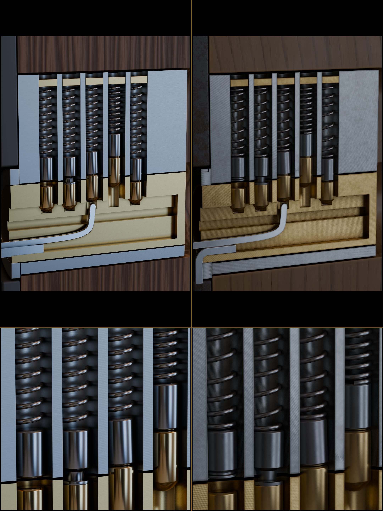

# Raport GEM4 — Warianty przekroju (1, 3, 5, 6 i 7 pinów), pełny napinacz oraz płyty Planu B

## 1. Podsumowanie wykonanych prac

Bez modyfikowania oryginalnego skryptu `art/blender/cutaway.py` (ani współdzielonej biblioteki `art/blender/lw_common.py`) utworzono w katalogu `art/blender/variants/` parametryczny zestaw narzędzi look-dev i wsadowego renderowania przekrojów cylindra zapadkowego:

1. **`art/blender/variants/cutaway_n.py`** — rozszerzony generator przekroju cylindra obsługujący:
   - **`--pins N` (`1..7`)**:
     - Dla **`N = 1` (S1)** i **`N = 3` (S2)** — 5-komorowa obudowa ćwiczebna o standardowym rozstawie (`PITCH = 4.0 mm`), w której nieużywane komory (`4` w wariancie 1-pinowym, `2` w wariancie 3-pinowym) są **fizycznie zaślepione** (`blank_plug_i` z czernionej, toczonej stali warsztatowej z górnym gniazdem pod wkrętak i przewężeniem ustalającym + mosiężna wkładka odcinająca na linii podziału `blank_core_i`).
     - Dla **`N = 5`** — pełny 5-pinowy cylinder referencyjny.
     - Dla **`N = 6`** i **`N = 7`** — wydłużony korpus obudowy, wieżyczka (`tower`) i bęben (`plug`) o długości `LEN = 30.0 + 4.0 * (TOTAL_CHAMBERS - 5)` mm (`34.0 mm` dla 6 pinów, `38.0 mm` dla 7 pinów) z automatycznym dopasowaniem kadru kamery, wycięcia w dębowych drzwiach i prowadzenia wytrycha.
   - **`--wrench-in-frame` oraz kąt napinacza (`--tension-angle 0..14`)**:
     - Kadr kamery obejmujący w całości cylinder oraz pełne ramię dolnego napinacza (`ARM_LEN = 19.5 mm`) na tle dolnego ramiaka drzwi i żeliwnego szyldu (`escutcheon`).
     - Parametryczny kąt wychylenia napinacza w zakresie **`0°–14°`** (zgodnie z D-12 i `HUD.md` §3) wraz z realistycznym, sprężystym ugięciem płaskownika pod obciążeniem (`bow`), obrotem 3D wokół osi bębna oraz diegetyczną płytką skali z mosiężnymi kołkami referencyjnymi dla **`0°`, `7°` i `14°`**.
     - Grawerowane kreski skali obrotu bębna na kołnierzu (`collar`) zgodnie z `HUD.md` §3.
   - **`--states s1,s2,...`** — indywidualne stany każdej komory (`set`/`a`, `spool`/`false_set`/`b`, `bind`/`c`, `overset`/`d`, `free`/`e`, `serrated`/`f`). Każdy stan różni się jednocześnie wysokością stosu, podcięciem/kształtem pina, luzem w kanale, kątem przekoszenia (`bind`), ugięciem sprężyny i pozycją grota wytrycha, dzięki czemu stany są jednoznacznie rozróżnialne również w czystej skali szarości (`.gray.png`).
   - **Poprawki jakości powierzchni i detali wg `contrib/gpt/T06/README.md` (pkt 3 i 4)**:
     - **Twardy próg chropowatości `roughness >= 0.16`** wymuszany węzłem `MAXIMUM` (`clamp_roughness_floor`) na każdym materiale metalicznym (brak lustrzanego chromu; w oryginalnym `cutaway.py` szum obniżał chropowatość mosiądzu pinów do `0.14`, a wytrycha do `0.12`).
     - **Anizotropia zgodna z kierunkiem obróbki (`machined_cut_metal`)**: dwustrefowy shader rozdzielający po współrzędnej `Y` płaszczyznę przekroju (`y ≈ 0`), na której widoczne są łuki posuwu głowicy frezarskiej (`RINGS / SPHERICAL`) połączone z poziomym szlifowaniem płaszczyznowym, od wnętrza cylindrycznych komór (`y > 0.12 mm`), gdzie widoczne są poziome pierścienie po rozwiercaniu (`BANDS / Z`). Piny mają wyraźne ślady toczenia (`marks='turn'`), a kanał klucza poziome ślady przeciągania (`broaching`).
     - **Zmatowione fazy (`bevel_matte` + `add_matte_chamfer_honing`)**: wszystkie ostre krawędzie cięcia obudowy, bębna i komór mają fazę z przypisanym zmatowionym materiałem (`nickel_chamfer` / `brass_chamfer`, `roughness = 0.55–0.56`) oraz przyciemnieniem krawędzi opartym o maskę AO (`_edge_mask`), co eliminuje białe, plastikowe odblaski na krawędziach przekroju.
     - **Ciemna szczelina linii podziału (`shear_liner`)**: szczelina `0.24 mm` między bębnem a obudową (`SHEAR = 6.38 mm`) zawiera cofniętą za płaszczyznę cięcia (`y = 0.32..1.8 mm`) matową czarną wkładkę pochłaniającą światło (`MAT['shear_shadow']`, `roughness = 0.98`), dzięki czemu linia podziału jest zawsze ostro odciętą ciemną szczeliną bez jasnego paska odbicia od tylnej ścianki otworu.
     - **Nieregularne sprężyny (`varied_spring`)**: każda komora ma własne ziarno generatora pseudolosowego determinujące fazę kąta początkowego, drobną odchyłkę liczby zwojów (`±0.45`), nieliniową falę skoku zwojów (`pitch_wave`) oraz subtelne wyboczenie boczne (`±0.045 mm`) i osobny wariant materiału.
   - **Geometria narzędzi (`clean_flat_tool`)**: konstrukcja wytrycha i napinacza oparta na czystej siatce czworokątów (`quad strip`) z łukowym kolanem napinacza (`R = 1.65 mm > height/2`), eliminująca samoprzecięcia wklęsłych wielokątów przy zgięciu 90°.
2. **`art/blender/variants/render_plate_n.py`** — skrypt wzorowany na `game/assets/photoreal/tools/render_plate.py`, generujący statyczne tła Planu B (`--plate`) z ukrytymi wszystkimi ruchomymi częściami (`key`, `drv`, `spr`, `pick`, `pick_handle`), tak aby nie zostawiały wypieczonego cienia ani odbić w komorach.
3. **`art/blender/variants/render_all_variants.py`** oraz **`art/blender/variants/render_all_variants.sh`** — wsadowe skrypty uruchamiające jednym poleceniem pełen zestaw 20 renderów Cycles GPU (`2160×2880`, 256 spp) + 10 konwersji do skali szarości (`.gray.png`) + zestawienie porównawcze `compare_before_after.png` oraz zapisujące manifest czasów i rozmiarów `render_manifest.json`.

---

## 2. Jak uruchomić jednym poleceniem

### Pełny zestaw wszystkich wariantów (1, 3, 5, 6, 7 pinów + `--wrench-in-frame` + `.gray.png` + `plates/` + porównanie przed/po)

Z poziomu powłoki (Bash / Git Bash):
```bash
bash art/blender/variants/render_all_variants.sh
```

Lub bezpośrednio przez Blendera / Pythona (Windows PowerShell / CMD / Linux / macOS):
```powershell
& "C:\Program Files\Blender Foundation\Blender 5.2\blender.exe" -b -P art/blender/variants/render_all_variants.py
```
*(Skrypt przyjmuje opcjonalne parametry po `--`, np. `-- --res 1080x1440 --samples 128 --device GPU`).*

### Pojedyncze wywołania przykładowe

```powershell
# Standardowy kadr, 3 aktywne piny (2 komory zaślepione — S2), stany jawne + zapis .gray.png:
blender -b -P art/blender/variants/cutaway_n.py -- --pins 3 --states set,bind,free --out art/renders/variants/cutaway_3pin.png

# Pełny napinacz w kadrze, 7 pinów, kąt napinacza 14°:
blender -b -P art/blender/variants/cutaway_n.py -- --pins 7 --wrench-in-frame --tension-angle 14.0 --out art/renders/variants/cutaway_7pin_wrench.png

# Statyczna płyta Planu B (bez ruchomych części), 5 pinów:
blender -b -P art/blender/variants/render_plate_n.py -- --pins 5 --out art/renders/variants/plates/plate_5pin.png
```

---

## 3. Sprzęt, parametry renderowania i czasy wykonania

- **Sprzęt**:
  - **GPU**: NVIDIA GeForce RTX 5070 (backend Cycles: `OPTIX`)
  - **CPU**: Intel Core Ultra 7 270K Plus (24 wątki)
  - **System**: Windows 11, Blender **5.2.1 LTS** (hash `9e2066aef7ef`)
- **Parametry docelowe**:
  - Rozdzielczość: **`2160 × 2880`** (proporcje pionowe `3:4`)
  - Próbkowanie: **`256 spp`** (Cycles GPU OptiX, adaptive threshold `0.006`)
  - Odszumianie: **OpenImageDenoise (OIDN)** z wejściami **`RGB_ALBEDO_NORMAL`**, tryb prefiltra `ACCURATE`
  - Głębia ostrości (DOF): **wyłączona (`use_dof = False`)** — pełna ostrość techniczna na całym przekroju
  - Transformacja barw: `AgX` (`AgX - Medium High Contrast`)
- **Całkowity czas wygenerowania wszystkich 31 plików**: **`1692,98 s` (`28 min 13 s`)**, średnio **`84,6 s`** na pełną scenę `2160×2880 @ 256 spp` (wliczając start Blendera, budowę siatek bmesh/boolean, pathtracing OptiX, denoise OIDN oraz eksport PNG + `.gray.png`).
- **Rozmiar plików**: wszystkie 31 plików PNG mieści się w przedziale **`3,49 MB – 6,34 MB`** (znacznie poniżej maksymalnego limitu `15 MB` na plik w repozytorium).

### Zestawienie wygenerowanych plików, czasów i rozmiarów

| Wariant | Ścieżka pliku kolorowego (`2160×2880`) | Rozmiar PNG | Ścieżka pliku w skali szarości (`.gray.png`) | Rozmiar `.gray.png` | Kąt napinacza | Czas renderu |
|---|---|---:|---|---:|---:|---:|
| **1 pin (S1, 4 zaślepione)** | `art/renders/variants/cutaway_1pin.png` | 5,56 MB | `art/renders/variants/cutaway_1pin.gray.png` | 3,94 MB | 6,0° | 72,09 s |
| **3 piny (S2, 2 zaślepione)** | `art/renders/variants/cutaway_3pin.png` | 5,60 MB | `art/renders/variants/cutaway_3pin.gray.png` | 3,97 MB | 6,0° | 81,99 s |
| **5 pinów (standard)** | `art/renders/variants/cutaway_5pin.png` | 5,63 MB | `art/renders/variants/cutaway_5pin.gray.png` | 3,99 MB | 6,0° | 78,86 s |
| **6 pinów** | `art/renders/variants/cutaway_6pin.png` | 5,51 MB | `art/renders/variants/cutaway_6pin.gray.png` | 3,91 MB | 6,0° | 64,29 s |
| **7 pinów** | `art/renders/variants/cutaway_7pin.png` | 5,38 MB | `art/renders/variants/cutaway_7pin.gray.png` | 3,84 MB | 6,0° | 67,85 s |
| **1 pin + pełny napinacz** | `art/renders/variants/cutaway_1pin_wrench.png` | 4,87 MB | `art/renders/variants/cutaway_1pin_wrench.gray.png` | 3,49 MB | 4,0° | 62,09 s |
| **3 piny + pełny napinacz** | `art/renders/variants/cutaway_3pin_wrench.png` | 4,92 MB | `art/renders/variants/cutaway_3pin_wrench.gray.png` | 3,52 MB | 7,0° | 63,78 s |
| **5 pinów + pełny napinacz** | `art/renders/variants/cutaway_5pin_wrench.png` | 4,97 MB | `art/renders/variants/cutaway_5pin_wrench.gray.png` | 3,55 MB | 10,0° | 66,43 s |
| **6 pinów + pełny napinacz** | `art/renders/variants/cutaway_6pin_wrench.png` | 4,91 MB | `art/renders/variants/cutaway_6pin_wrench.gray.png` | 3,52 MB | 12,0° | 94,02 s |
| **7 pinów + pełny napinacz** | `art/renders/variants/cutaway_7pin_wrench.png` | 4,86 MB | `art/renders/variants/cutaway_7pin_wrench.gray.png` | 3,49 MB | 14,0° | 115,29 s |
| **Płyta Planu B — 1 pin** | `art/renders/variants/plates/plate_1pin.png` | 5,57 MB | — | — | 6,0° | 104,60 s |
| **Płyta Planu B — 3 piny** | `art/renders/variants/plates/plate_3pin.png` | 5,65 MB | — | — | 6,0° | 84,46 s |
| **Płyta Planu B — 5 pinów** | `art/renders/variants/plates/plate_5pin.png` | 5,70 MB | — | — | 6,0° | 107,62 s |
| **Płyta Planu B — 6 pinów** | `art/renders/variants/plates/plate_6pin.png` | 5,60 MB | — | — | 6,0° | 83,35 s |
| **Płyta Planu B — 7 pinów** | `art/renders/variants/plates/plate_7pin.png` | 5,49 MB | — | — | 6,0° | 79,74 s |
| **Płyta Planu B — 1 pin (napinacz)** | `art/renders/variants/plates/plate_1pin_wrench.png` | 4,88 MB | — | — | 4,0° | 92,44 s |
| **Płyta Planu B — 3 piny (napinacz)** | `art/renders/variants/plates/plate_3pin_wrench.png` | 4,97 MB | — | — | 7,0° | 107,07 s |
| **Płyta Planu B — 5 pinów (napinacz)** | `art/renders/variants/plates/plate_5pin_wrench.png` | 5,05 MB | — | — | 10,0° | 96,43 s |
| **Płyta Planu B — 6 pinów (napinacz)** | `art/renders/variants/plates/plate_6pin_wrench.png` | 5,02 MB | — | — | 12,0° | 88,57 s |
| **Płyta Planu B — 7 pinów (napinacz)** | `art/renders/variants/plates/plate_7pin_wrench.png` | 4,99 MB | — | — | 14,0° | 81,24 s |
| **Zestawienie Przed / Po** | `art/renders/variants/compare_before_after.png` | 6,34 MB | — | — | — | — |

---

## 4. Porównanie Przed / Po z `art/renders/section.png` (`section.jpg`)

Plik `art/renders/variants/compare_before_after.png` zestawia dotychczasowy render referencyjny `art/renders/section.jpg` (lewa kolumna — u góry pełny kadr, na dole zbliżenie 1:1 na komory 1–4 i linię podziału) z nowym renderem `art/renders/variants/cutaway_5pin.png` z `cutaway_n.py` (prawa kolumna).



### Kluczowe różnice jakościowe (wg `contrib/gpt/T06/README.md` pkt 3 i 4 oraz `docs/styles/realizm.md`):

1. **Brak lustrzanego chromu (`roughness >= 0.16`)**:
   - **Przed (`cutaway.py`)**: piny (`M['brass_k']`, `M['steel']`) i wytrych (`M['pick']`) korzystały ze starszych definicji materiałów v1 bez śladów toczenia i ze spadkiem chropowatości do `0.12–0.14`, co dawało syntetyczne, pionowe białe pasy lustrzanego odbicia na cylindrach.
   - **Po (`cutaway_n.py`)**: wszystkie metale mają wymuszony próg `roughness >= 0.16` (mosiądz bębna `0.24`, niklowana obudowa `0.29`, piny mosiężne `0.20–0.22`, piny stalowe `0.23–0.25`) oraz wyraźną mikrostrukturę po toczeniu (`marks='turn'`), dzięki czemu bliki rozpraszają się kierunkowo jak na prawdziwym toczonym mosiądzu i stali.
2. **Anizotropia zgodna z kierunkiem obróbki na płaszczyźnie przekroju i w komorach**:
   - **Przed**: płaszczyzna cięcia obudowy i bębna była jednolicie gładka (w `lw_common.py` `marks='mill'` miał zerową skalę w osi Y i zbyt dużą częstotliwość), a wnętrza komór nie różniły się fakturą od czoła przekroju.
   - **Po**: czoło przekroju (`y ≈ 0`) ma czytelne, ukośne łuki po frezowaniu czołowym (`RINGS / SPHERICAL`) połączone z poziomym szlifem, kanał klucza ma poziome rysy po przeciąganiu, a półcylindryczne wnętrza komór (`y > 0.12 mm`) mają poziome pierścienie po rozwiercaniu.
3. **Zmatowione fazy (`zmatowione fazy`)**:
   - **Przed**: fazowania (`bevel`) używały tego samego materiału co polerowane lico, tworząc cienkie, świecące obwódki wokół komór i krawędzi bębna.
   - **Po**: modyfikator `bevel_matte` przypisuje ściankom faz osobny, zmatowiony materiał (`roughness = 0.55–0.56`) wspierany maską krawędziową `_edge_mask`, co daje naturalny wygląd krawędzi po gratowaniu warsztatowym.
4. **Ciemna szczelina linii podziału (`ciemna szczelina linii podziału bez jasnego paska`)**:
   - **Przed**: w szczelinie `0.20 mm` między bębnem a obudową światło odbijało się od tylnej ścianki otworu, tworząc miejscami jasny pasek utrudniający odczyt progu.
   - **Po**: powiększona do `0.24 mm` szczelina z wewnętrznym czarnym linerem pochłaniającym światło (`shear_liner`, `y = 0.32..1.8 mm`, `roughness = 0.98`) gwarantuje głęboko czarną, bezodblaskową linię podziału na całej szerokości cylindra (zarówno w kolorze, jak i w skali szarości).
5. **Zróżnicowane sprężyny i naturalny dąb (`oak()`)**:
   - **Przed**: sprężyny miały identyczną fazę i stały skok zwojów, a drewno drzwi miało poziome, rzadkie pasy (`wood()` v1).
   - **Po**: każda sprężyna ma indywidualną fazę, mikrozmienność skoku i lekkie wyboczenie boczne (`varied_spring`), a drzwi korzystają z proceduralnego dębu `oak()` z pionowym usłojeniem i porami drewna.
