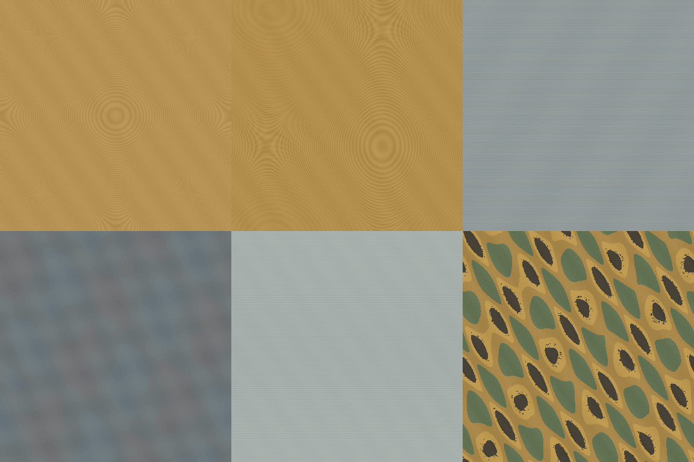
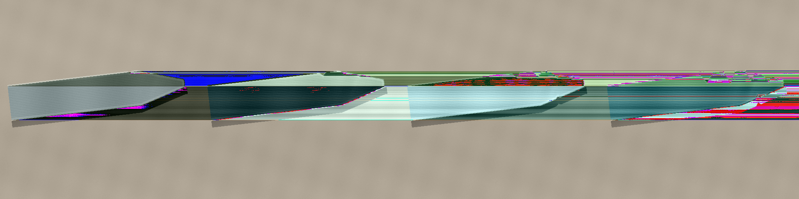

# G06 — zbliżenia metalu: obróbka i zużycie

**Status:** gotowe, 2026-11-05. **Repozytorium:** `woogitsugames/lockwright`, katalog `contrib/gpt/G06/`.

## Zakres

Przygotowano sześć autorskich materiałów, każdy w wersji **height** (8-bitowa skala szarości) i **albedo** (8-bitowy PNG z paletą RGB), wszystkie **2048 × 2048 px** i **tileable** w obu osiach. Ponadto dodano cztery osobne obrazy zużytej końcówki fikcyjnego metalowego narzędzia (2048 × 2048 px, celowo nie-tileable) oraz dwie plansze podglądowe. Brak oświetlenia, odbić, logo i tekstów w mapach materiałowych.

## Wykaz plików

| Materiał (PL / EN) | Height | Albedo |
|---|---|---|
| Mosiądz toczony / Turned brass | `materials/turned_brass_height.png` | `materials/turned_brass_albedo.png` |
| Mosiądz frezowany czołowo / Face-milled brass | `materials/face_milled_brass_height.png` | `materials/face_milled_brass_albedo.png` |
| Stal szlifowana / Ground steel | `materials/ground_steel_height.png` | `materials/ground_steel_albedo.png` |
| Stal hartowana z nalotem / Heat-tinted hardened steel | `materials/heat_tinted_steel_height.png` | `materials/heat_tinted_steel_albedo.png` |
| Polerowana stal sprężynowa / Polished spring steel | `materials/spring_steel_height.png` | `materials/spring_steel_albedo.png` |
| Mosiądz patynowany ze smarem / Patinated brass with grease | `materials/aged_brass_grease_height.png` | `materials/aged_brass_grease_albedo.png` |

Obrazy zużycia: `wear/tool_tip_wear_80.png` (delikatne nacięcia), `wear/tool_tip_wear_60.png` (kilka nacięć), `wear/tool_tip_wear_40.png` (większe zadziory) oraz `wear/tool_tip_wear_20.png` (silne wyszczerbienia). Wartości 80/60/40/20 oznaczają procent zachowanej integralności.

Podglądy: `previews/material_contact_sheet.png` (**1152 × 768**, układ 3 kolumny × 2 rzędy, kolejność materiałów zgodna z tabelą); `previews/wear_contact_sheet.png` (**2048 × 512**, kolejno 80, 60, 40, 20).

Generator: `generate.js` — odtwarzalny kod JavaScript dla Node.js 22+, bez pakietów i plików zewnętrznych. Uruchom `node generate.js` w katalogu G06, aby odtworzyć wszystkie PNG.

## Integracja z Godot 4.7

1. Używaj powtarzalnych UV i włącz `repeat` dla map materiałowych. Albedo jest sRGB, height musi być traktowany jako dane liniowe.
2. Mapy height służą do mikroreliefu (bump/normal). Dopuszczalne jest wyprowadzenie z nich roughness, ale wymaga remapowania i walidacji: orientacyjny zakres **0,30–0,72**, minimum 0,16; surowe wartości height nie są fizycznie skalibrowaną roughness.
3. Na linii podziału mechanizmu zachowaj czystą strefę ±1 dp, bez odblasków i wysokokontrastowej faktury (`docs/DESIGN.md`, `docs/HUD.md`).
4. Obrazy zużycia są wizualnymi referencjami do warsztatu i widoku przez lupę, nie maską alfa ani gotową geometrią 3D. Sylwetkę narzędzia należy odtworzyć w modelu.

## Kontrola jakości

- Wymiary: 12 map + 4 obrazy zużycia po **2048 × 2048 px**, podglądy **1152 × 768** i **2048 × 512 px**.
- Porównanie rozpakowanych pikseli: wszystkie 12 map mają identyczne pierwszą i ostatnią kolumnę oraz identyczne pierwszy i ostatni wiersz (**maksymalna różnica 0**).
- Wszystkie **18 PNG poniżej 2 MB** każdy, poniżej wymaganego limitu 20 MB; dekodowanie PNG zweryfikowane.
- Wszystkie zasoby powstały kodem i bez materiałów stockowych, zgodnie z wpisami w `ASSETS.md`.

## Ograniczenia i dalsze kroki

- To proceduralne, koncepcyjne mapy detalu, a nie zmierzone skany PBR. Zalecany finalny look-dev w Blenderze/Cycles i w Godot na fizycznym modelu, ze skalowaniem UV i osobną mapą roughness.
- `docs/HUD.md` przewiduje pięć stanów integralności **100/80/60/40/20**; w tym zadaniu przygotowano cztery stany *zużyte* (80/60/40/20), zgodnie ze zleceniem. Stan 100% może wykorzystywać gładką geometrię bazową.
- Odczytano `CLAUDE.md`, `docs/styles/realizm.md`, `docs/DESIGN.md` i `docs/HUD.md`. Obiekty `art/renders/section.png` i `art/renders/loupe.png` odnaleziono w repozytorium, ale dostępne narzędzie nie udostępniło ich pikseli; należy porównać końcowy look-dev z tymi renderami.
- Nalot cieplny na stali hartowanej celowo pozostaje bardzo subtelny, bez neonowych barw. Kształt narzędzia nie prezentuje pracy w mechanizmie.
