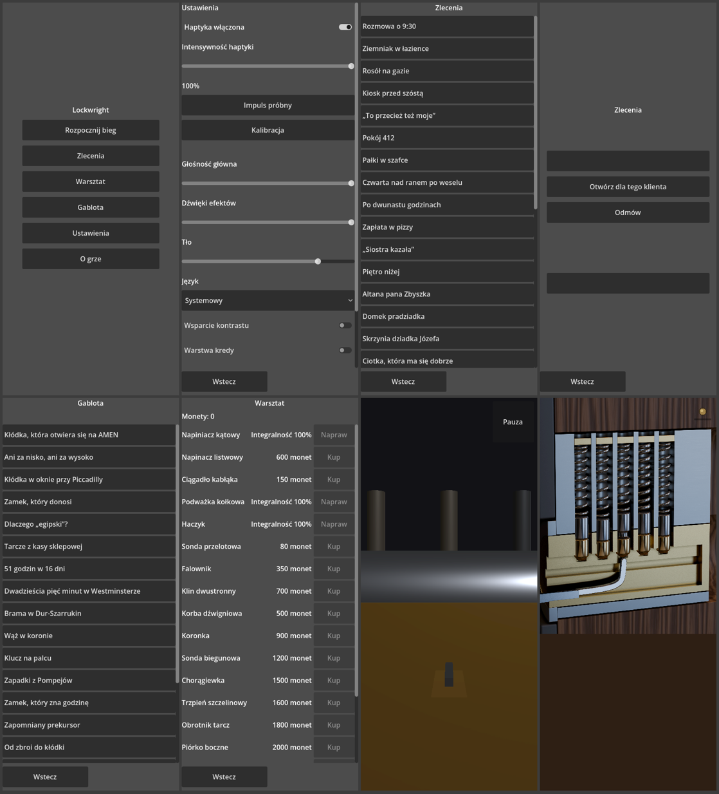
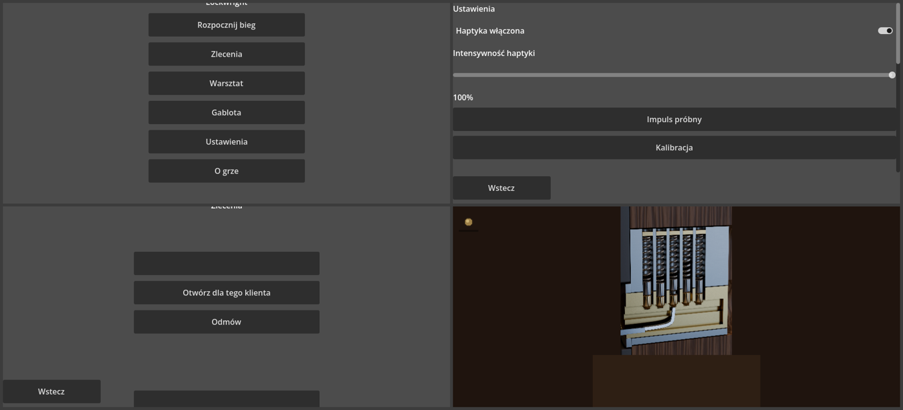

# Audyt dostępności — gra i makiety (sesja C, etap 2)

Data: 2026-11-05 · Zakres: `game/` (HEAD po commitach sesji B 9981ec0 i sesji A ze sceną `scenes/photoreal/lock_photoreal.tscn`), `mockups/realizm/`.
Kryteria: `CLAUDE.md` (zasady wizualne), `docs/DESIGN.md` (kod stanów), Xbox Accessibility Guidelines (XAG) 101 (tekst), 102 (kontrast), 103 (dodatkowe kanały), 106 (cele wejścia), 110 (haptyka), 114 (kody kolorów).
Metoda: czytanie scen i skryptów, zrzuty z Godota 4.7.2 (kopia `game/`, Xvfb + lavapipe, **PL**, 412×915 pion i 915×412 poziom), kontrast WCAG liczony z pikseli zrzutów (luminancja względna, percentyle 90/10). Kodu gry nie zmieniałem — poprawki należą do sesji B (`game/`) i A (`game/*/photoreal/`).

## Podsumowanie

| Kryterium | Stan | Uwagi |
|---|---|---|
| Cele dotyku ≥ 48 dp | **spełnione** | wszystkie przyciski, suwaki i przełączniki mają `custom_minimum_size` z wysokością 48; akcje warsztatu 96×48; pauza 96×96 (stary ekran) i klapka 48×48 (plan B) |
| Elementy ≥ 28 dp | **częściowo** | widoczna część klapki pauzy w planie B ma ok. 14 dp (A-03) |
| Kontrast metal / tło ≥ 3:1 | **spełnione** | ekran planu B 7,8:1; makieta realizmu 7,5:1 (p90 metalu vs p10 tła) |
| Kontrast tekstu (WCAG AA 4,5:1) | **spełnione w menu** | domyślny motyw Godota: jasnoszary tekst na ciemnoszarym przycisku ok. 9–12:1; etykiety na tle `#4d4d4d` ok. 7:1 |
| Stany rozróżnialne bez koloru (DESIGN §kod stanów) | **spełnione w planie B** | stany kołka kodowane pozycją, szczeliną, przechyłem i ruchem (`pin_pose.gd`: SET_GAP, SET_DROP, BIND_TILT_DEG, overset), stres = wygięcie i drżenie wytrycha; stary `lock.tscn` po R-29 używa odcieni szarości + kształtu |
| Haptyka nigdy jedynym kanałem (XAG 103/110) | **spełnione w kodzie** | każde zdarzenie idzie do `Haptics`, `Sfx` i obrazu (`lock_photoreal.gd:119-131`); opór ciągły ma pętlę dźwięku i obrót rdzenia |
| Dźwięk nigdy jedynym kanałem | **częściowo** | w trybie normalnym obraz jest; brak opisu, jak gra wygląda dla osób niesłyszących w trybie „w ciemności” (A-06) |
| Safe-area | **częściowo** | ekran zamka (oba) liczy safe-area; **menu, ustawienia, zlecenia, gablota, warsztat — nie** (A-01) |
| Pion podstawowy, poziom sprawdzony | **pion OK, poziom z błędami** | A-02 |
| Krój pisma | **niespełnione** | menu na domyślnym foncie Godota jako jedynym kroju — zakaz z CLAUDE.md (A-04) |
| Animacje 100–250 ms | **do weryfikacji na urządzeniu** | w kodzie stałe wygładzania stanu w planie B; brak przełącznika „ogranicz ruch” (A-07) |
| Rozmiar tekstu | **częściowo** | domyślne 16 px; brak skalowania tekstu w ustawieniach (A-05) |

## Uwagi

**A-01 · High · Menu bez safe-area** · `game/scenes/main_menu.tscn`, `settings.tscn`, `jobs_list.tscn`, `job_*.tscn`, `showcase.tscn`, `workshop.tscn`
- Tytuły („Ustawienia”, „Zlecenia”, „Gablota”, „Warsztat”) zaczynają się 6–10 px od górnej krawędzi, a przyciski „Wstecz” 4–8 px od dołu. Na telefonach z wcięciem lub wyspą tytuł wejdzie pod pasek stanu, a „Wstecz” pod gest powrotu (iOS home indicator ok. 34 pt).
- **Poprawka:** wspólny kontener (`MarginContainer`) z marginesami z `DisplayServer.get_display_safe_area()` przeliczonymi na jednostki płótna, tak jak w `lock_scene.gd:53` i `lock_photoreal_view.gd:409`.

**A-02 · Medium · Poziom: ucięte tytuły i nakładające się elementy** · `main_menu.tscn`, `job_verify.tscn` (zrzut poziomy)
- W 915×412 tytuł „Lockwright” i „Zlecenia” są ucięte u góry, a w weryfikacji zlecenia „Wstecz” nachodzi na dolną kartę. Treść nie mieści się w wysokości 412, a kontenery nie przewijają się.
- **Poprawka:** `ScrollContainer` dla list i kart albo układ dwukolumnowy w poziomie; sprawdzić każdą scenę w 915×412 (DESIGN: „pion podstawowy, poziom sprawdzony”).

**A-03 · Medium · Klapka pauzy w planie B: cel 48 dp, ale widoczny znak ok. 14 dp** · `game/scripts/photoreal/lock_photoreal_view.gd:36, 353, 391-395` (sesja A)
- Obszar dotyku ma 48×48 (OK), ale rysowany jest tylko mały mosiężny guzik. CLAUDE.md: elementy ≥ 28 dp. Gracz, który nie wie, że tam jest pauza, jej nie znajdzie (D-12 robi z niej jedyną afordancję).
- **Poprawka:** widoczna klapka zwijki ≥ 28 dp (np. skórzany róg 32×32 dp z przeszyciem), kontrast z tłem ≥ 3:1.

**A-04 · Medium · Domyślny font Godota jako jedyny krój** · motyw projektu (brak `theme` w `project.godot`)
- Menu, ustawienia i listy używają wbudowanego fontu silnika. CLAUDE.md zabrania „Inter/Roboto/systemowy jako jedyny krój”; kierunek realizmu ma Bona Nova + Atkinson Hyperlegible Next (OFL, już w `mockups/fonts/` i w ASSETS).
- **Poprawka:** jeden `Theme` (`game/theme/main.tres`) z Atkinson Hyperlegible Next (tekst, czytelność dla słabowidzących) i Bona Nova (nagłówki) przypięty w `gui/theme/custom`.

**A-05 · Medium · Brak skalowania tekstu** · `settings.tscn`
- Tekst 16 px bez opcji powiększenia (XAG 101). Ustawienia mają „Wsparcie kontrastu” i „Warstwę kredy”, ale nie rozmiar tekstu.
- **Poprawka:** suwak „Rozmiar tekstu” 100/125/150% zmieniający `default_font_size` w motywie; sprawdzić, że listy przewijają się przy 150%.

**A-06 · Medium · Tryb „w ciemności” a osoby niesłyszące** · biblia treści (`docs/PROGRESSION.md`, `docs/DESIGN.md`)
- Tryb opiera się na haptyce i dźwięku. Bez słuchu zostaje tylko haptyka, a na iPadzie (H0) nic. Jeśli tryb da osiągnięcia lub treść niedostępną inaczej, wyklucza część graczy.
- **Poprawka:** tryb opcjonalny, bez nagród na wyłączność; w ustawieniach informacja, że wymaga dźwięku (i haptyki na telefonie).

**A-07 · Low · Brak „ogranicz ruch”** · `settings.tscn`
- Drżenie wytrycha przy stresie (`lock_photoreal_view.gd:498-501`) i ruchy kamery/kołków nie mają przełącznika ograniczenia ruchu (iOS: `UIAccessibility.isReduceMotionEnabled`).
- **Poprawka:** opcja „ogranicz ruch”: zamiast drżenia statyczne wygięcie + dźwięk „śpiewania” (kanał dźwiękowy już jest).

**A-08 · Low · Pusta karta na ekranie weryfikacji bez zlecenia** · `job_verify.tscn` (zrzut pionowy)
- Uruchomiony bez wybranego zlecenia pokazuje puste prostokąty. Dla czytników ekranu i gracza to „martwe” elementy. Razem z N-04 z przeglądu: karta powinna mieć tytuł i opis przedmiotu (D-25).

**A-09 · Low · Brak opisów dla czytników ekranu** · wszystkie sceny
- Godot 4.7 ma wsparcie dostępności (AccessKit) na desktopie; na mobile jest ograniczone. Przyciski z samym tekstem są OK; klapka pauzy i koło stuknięć nie mają nazw. **Poprawka:** ustawić `accessibility_name` (gdzie silnik je obsługuje) dla elementów bez tekstu.

## Makiety (`mockups/realizm/`)

- `01-lock` i `02-loupe` (pion i poziom, skala szarości i 50% jasności w `mockups/realizm/png/`): kontrast metalu do tła 7,5:1; stany w makiecie rozróżnialne kształtem (szczelina, wysokość, przechył); brak paneli na ekranie zamka (D-12) — zgodne.
- W `realizm.css` paleta ma tylko `--ink`; reszta kolorów jest w obrazach. Narzędzie `mockups/tools/contrast.mjs` wymaga `realizm/palette.json` — **brakuje go**, więc automatyczny raport kontrastu dla realizmu nie działa (Low, sesja A).

## Co sprawdzono / czego nie
- Sprawdzono: sceny z `game/scenes/*.tscn` i `scenes/photoreal/lock_photoreal.tscn` na desktopie (lavapipe), PL, pion i poziom; skrypty widoku i zdarzeń.
- Nie sprawdzono: prawdziwy telefon (safe-area, gesty systemowe, TalkBack/VoiceOver), kontrast w trybie „Wsparcie kontrastu” (przełącznik nie zmienia nic widocznego na zrzutach desktopowych), czas animacji na urządzeniu.
