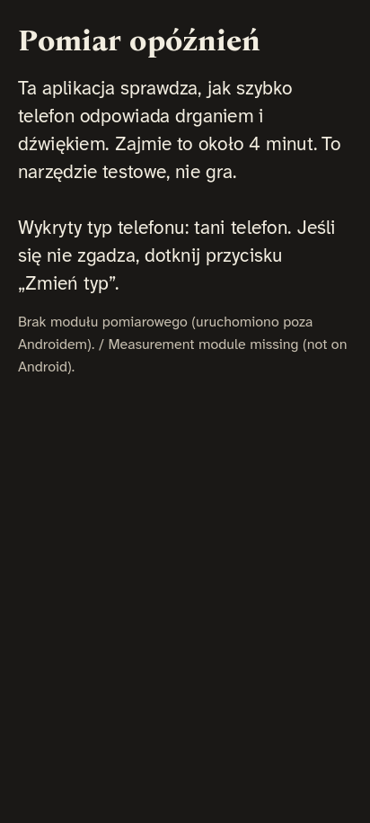
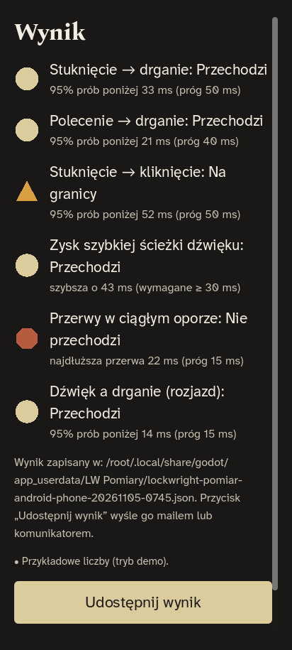

# Pomiary na Twoich telefonach (D-33) — instrukcja krok po kroku

Ta instrukcja jest dla Ciebie, nie dla programisty. Mierzymy, jak szybko telefon odpowiada **drganiem** i **dźwiękiem** — od tego zależy, czy zostajemy przy Godocie (`docs/TECH.md` §4, spike'i 1–3). Nie trzeba kupować żadnego sprzętu: aplikacja „LW Pomiary” używa akcelerometru i mikrofonu samego telefonu.

Czas: ok. 10 minut na pierwszy telefon (z instalacją), potem ok. 4 minuty na każdy kolejny.

---

## 1. Pobierz aplikację z GitHuba

1. Wejdź na **github.com/woogitsugames/lockwright** i zaloguj się.
2. Kliknij zakładkę **Actions** (u góry), a po lewej workflow **spike-measure**.
3. Kliknij najnowszy wiersz z zieloną ikoną (✓ przy nazwie commita).
4. Przewiń na dół do sekcji **Artifacts**:
   - **`measure-android-apk`** — Android,
   - **`measure-ios-unsigned`** — iPhone (patrz punkt 3, tu jest haczyk).
5. Kliknij nazwę. Pobierze się plik `.zip`. Rozpakuj go (na komputerze albo od razu na telefonie w aplikacji „Pliki”).

Artefakty są dostępne przez 90 dni od zbudowania. Jeśli lista jest pusta, napisz do mnie (następna sesja) — zbuduję ponownie.

## 2. Android — instalacja

1. Przenieś plik **`lw-pomiary.apk`** na telefon (kabel, Dysk Google, mail do siebie) albo pobierz ZIP od razu na telefonie.
2. Na telefonie otwórz aplikację **Pliki** i dotknij `lw-pomiary.apk`.
3. Telefon zapyta, czy pozwolić tej aplikacji (np. „Pliki” albo „Chrome”) **instalować nieznane aplikacje**. Wybierz **Ustawienia → Zezwalaj z tego źródła**, wróć i dotknij **Zainstaluj**.
4. Play Protect może pokazać ostrzeżenie „Nieznany deweloper” — to normalne dla aplikacji testowej spoza sklepu. Wybierz **Zainstaluj mimo to** (czasem pod „Więcej szczegółów”).
5. Na ekranie pojawi się ikona **LW Pomiary**.

Po pomiarach możesz ją odinstalować jak każdą aplikację.

## 3. iPhone — instalacja (uczciwie: tu potrzebny jest Mac albo płatne konto)

Apple nie pozwala zainstalować aplikacji spoza App Store bez podpisu. Artefakt `measure-ios-unsigned` jest **niepodpisany**, więc sam w sobie na iPhone'a nie wejdzie. Są trzy drogi:

| Droga | Czego potrzeba | Ile kosztuje | Uwagi |
|---|---|---|---|
| **A. Xcode na Macu, darmowe Apple ID** | Mac z Xcode 26, kabel USB, Twoje Apple ID | 0 zł | Aplikacja działa 7 dni, potem trzeba powtórzyć. Kroki niżej. |
| **B. TestFlight** | Konto **Apple Developer Program** (99 USD/rok) + klucz API w sekretach repo | 99 USD/rok | Najwygodniejsze: instalacja z aplikacji TestFlight jednym dotknięciem. Konto i tak będzie potrzebne do publikacji gry. Ustawienie CI: `docs/TECH.md` §5.4. |
| C. Pominąć iPhone'a na razie | — | 0 | Spike 1 (iPhone) zostaje niezmierzony; Android daje odpowiedź dla spike'ów 2–3. |

**Droga A (darmowa, z Maca), krok po kroku:**
1. Na Macu zainstaluj **Xcode** z App Store i **XcodeGen** (`brew install xcodegen` w Terminalu; jeśli nie masz Homebrew, instrukcja: brew.sh).
2. Pobierz repo (zielony przycisk **Code → Download ZIP** na GitHubie) i rozpakuj.
3. W Terminalu: `cd ~/Downloads/lockwright-main/spikes/measure/ios && xcodegen generate && open LWMeasure.xcodeproj` (nazwę pliku `.xcodeproj` zobaczysz w katalogu).
4. W Xcode: kliknij projekt po lewej → zakładka **Signing & Capabilities** → **Team: Add an Account…** → zaloguj się swoim Apple ID → wybierz „(Personal Team)”. Jeśli Xcode zgłosi zajęty identyfikator, dopisz cokolwiek na końcu **Bundle Identifier** (np. `.mateusz`).
5. Podłącz iPhone'a kablem, odblokuj go, u góry Xcode wybierz swój telefon i kliknij ▶ (Run).
6. Na iPhonie: **Ustawienia → Ogólne → VPN i urządzenia** → Twoje Apple ID → **Ufaj**. Przy pierwszym uruchomieniu iOS 18 może też poprosić o włączenie **Trybu dewelopera** (Ustawienia → Prywatność i ochrona → Tryb dewelopera → włącz, restart).

## 4. Pomiar — co kliknąć

Przygotuj: **twardy stół**, ciszę w pokoju, wyłączony tryb cichy, głośność multimediów ok. 70%. Nie trzymaj telefonu w ręku (poza krokiem ze stuknięciami — wtedy telefon nadal leży, tylko stukasz palcem).

| Ekran | Co robisz |
|---|---|
| **Pomiar opóźnień** | Sprawdź, czy typ telefonu się zgadza (Pixel / flagowiec, średnia półka, tani). Jeśli nie, dotknij **Zmień typ**. Potem **Zaczynamy**. |
| **Przygotowanie** | Połóż telefon ekranem do góry na stole i dotknij **Gotowe**. |
| **Krok 1: drgania** | Nic nie dotykasz. Telefon ok. 15 s krótko wibruje. |
| **Krok 2: ciągły opór** | Nic nie dotykasz. 4 s lekkiego drżenia. |
| **Krok 3: dźwięk** | Telefon zapyta o **mikrofon** → **Zezwól** (tylko podczas używania aplikacji). Potem 60 kliknięć; nie mów i nie dotykaj telefonu. Nic nie jest nagrywane na stałe ani wysyłane. |
| **Krok 4: stuknięcia** | Stuknij opuszką palca w środek koła **20 razy**, spokojnie, mniej więcej raz na sekundę. Licznik pokazuje, ile zostało. |
| **Wynik** | Lista wyników ze słowami: **Przechodzi**, **Na granicy**, **Nie przechodzi**, **Brak danych** (kształt obok: koło, trójkąt, ośmiokąt, pusty pierścień). |

 

Jeśli wynik wygląda dziwnie (dużo „Brak danych”), powtórz pomiar na twardszym stole i w cichszym pokoju — przycisk **Powtórz pomiar**.

## 5. Gdzie wkleić wynik

1. Na ekranie wyniku dotknij **Udostępnij wynik**. Otworzy się systemowe okno udostępniania.
2. Wybierz **Gmail / Mail** i wyślij do siebie, albo **Dysk Google / Pliki** — to tekst w formacie JSON (zaczyna się od `{"schema": "lockwright.measure/1"`).
   - Android dodatkowo sam zapisuje plik w **Pobrane/Lockwright/** (`lockwright-pomiar-android-<model>-<data>.json`).
3. Wrzuć plik do repo — najprościej przez stronę GitHuba:
   - wejdź w katalog **`spikes/measure/results/`** (jeśli go nie ma: **Add file → Create new file**, w nazwie wpisz `spikes/measure/results/` i nazwę pliku),
   - **Add file → Upload files** (albo wklej tekst JSON przy „Create new file”, nazwa pliku `telefon-data.json`),
   - na dole **Commit changes** (bez zmian w opcjach).
4. Następna sesja (albo ktokolwiek) uruchomi `python3 spikes/measure/tools/ingest.py spikes/measure/results/*.json` — skrypt sam przeliczy werdykty i dopisze tabelę do `docs/TECH.md` (rozdział „Wyniki pomiarów na telefonach właściciela”).

## 6. Co dokładnie mierzymy (dla ciekawych)

| Wynik | Co to znaczy | Próg (TECH §4) |
|---|---|---|
| Stuknięcie → drganie | Od uderzenia palca w szybę (widać je w akcelerometrze) do początku wibracji. Obejmuje ekran dotykowy, aplikację i silnik wibracji. | Pixel ≤ 35 ms, średnia półka ≤ 50 ms, tani ≤ 100 ms (p95) |
| Polecenie → drganie | Od wywołania funkcji wibracji do drgań — sam silnik wibracji. | pomocniczo |
| Stuknięcie → kliknięcie | Od odgłosu stuknięcia (mikrofon) do kliknięcia z głośnika (szybka ścieżka Oboe). | Pixel ≤ 35 ms, średnia ≤ 50 ms, tani ≤ 80 ms (p95) |
| Zysk szybkiej ścieżki dźwięku | O ile nasza ścieżka (Oboe) gra szybciej niż zwykły dźwięk Godota. | ≥ 30 ms |
| Przerwy w ciągłym oporze | Najdłuższa przerwa w „ciągłym” drżeniu (czy opór się rwie). | ≤ 15 ms |
| Dźwięk a drganie | Rozjazd kliknięcia i wibracji tego samego zdarzenia. | ≤ 15 ms |

Dokładność: Android z akcelerometrem ≥ 200 Hz — ok. 2–5 ms (wystarcza na decyzję zgodnie z D-33). iPhone ma akcelerometr ok. 100 Hz — dokładność ok. ±10 ms; przy wynikach „na granicy” wracamy do pomiaru piezo (D-33).

## 7. Dodatkowo: wydajność planu B (spike 4)

Plan B (ekran zamka z wypieczonym renderem, D-31) mierzymy osobną aplikacją: artefakt **`spike-lit-metal-debug-apk`** (workflow **spike-lit-metal**). Instalacja jak w punkcie 2. Po uruchomieniu:
- prawy górny róg ekranu przełącza wariant A ⇄ B (napis w lewym górnym rogu),
- na ekranie widać FPS i czas klatki; zostaw telefon na 10 minut w wariancie B,
- zrób zrzut ekranu po 1 minucie i po 10 minutach (przyciski zasilania + głośność w dół) i wrzuć oba do `spikes/lit-metal/results/` tak jak JSON w punkcie 5.

Gdy sesja A doda scenę zamka do gry (`game/scenes/photoreal/`), dojdzie osobny APK z prawdziwym ekranem zamka i licznikiem — opis pojawi się tutaj.
