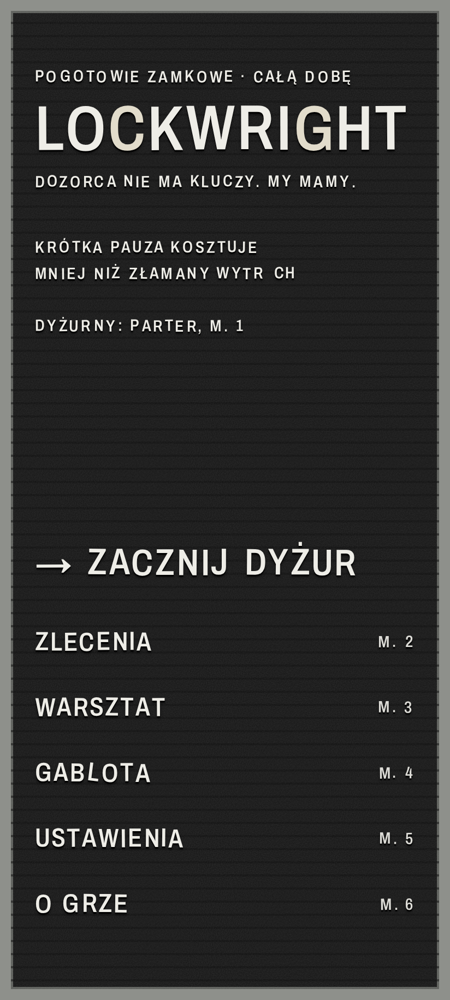
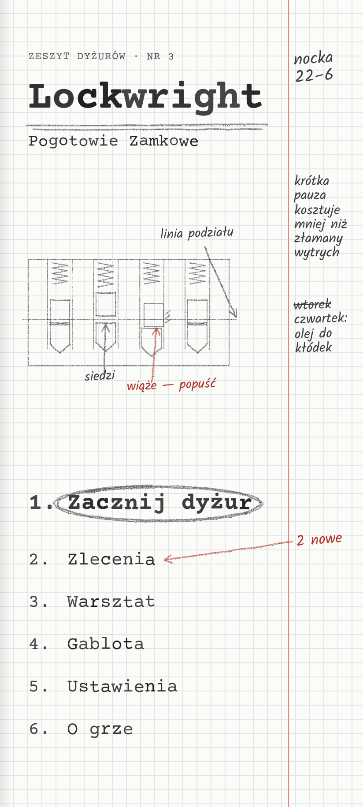
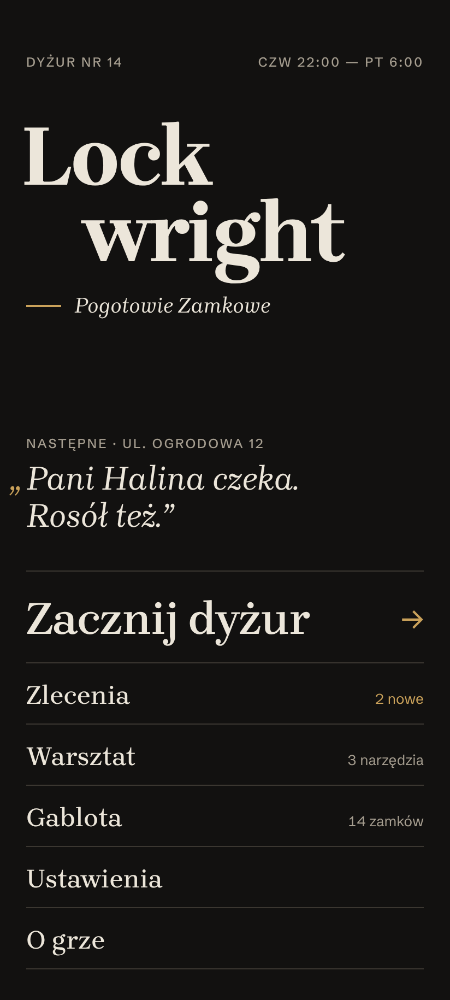
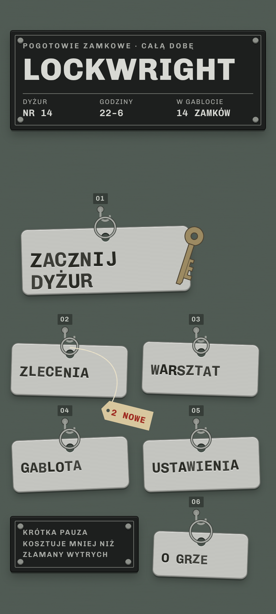

# Kierunki UI menu: 4 propozycje (2026-11-05)

Status: **propozycja do wyboru przez właściciela.** Dotyczy menu poza zamkiem (menu główne, zlecenia, ustawienia i dalej warsztat, gablota, „O grze”). HUD w zamku dalej opisuje `HUD.md`, a świat gry `realizm.md` (D-05).

Makiety: `mockups/ui-directions/<n>-<slug>/index.html?s=menu|jobs|settings`. Render: `node mockups/ui-directions/render.mjs` (412×915 i 915×412 @2x plus kopie w skali szarości w `out/<kierunek>/gray/`). Zestawienie: `mockups/ui-directions/out/compare.png`.

## Diagnoza obecnego stanu (dlaczego „AI slop”)
1. Każdy ekran to stos zaokrąglonych kart w kolorze kremowym lub ciemnym, czyli układ SaaS przebrany za warsztat.
2. Błyszczące emaliowane tabliczki w przypadkowych kolorach (granat, zieleń, bordo) z odblaskiem.
3. Wyśrodkowany ozdobny szeryfowy tytuł z podtytułem, prosto z szablonu.
4. Pod każdym ekranem przyciemnione i rozmyte zdjęcie.
5. Wszystko ma tę samą wagę i nic nie jest diegetyczne.

Wspólne zasady wszystkich czterech kierunków:
- **Jeden materiał i jedna gramatyka na kierunek.** Nie ma kart „na wszelki wypadek”.
- **Stan pokazuje kształt, a nie kolor:** złożona kartka, przekreślenie, dziurki z kasownika, przywieszka, kursywa. Wszystko sprawdzone w skali szarości (`out/*/gray/`).
- **Hierarchia:** „Zacznij dyżur” zawsze ma inną wagę niż reszta (rozmiar, kształt, przedmiot), a pozostałe pozycje są równorzędne.
- **Menu leży w dolnej połowie ekranu**, w zasięgu kciuka. Tytuł jest u góry i wyrównany do lewej, nigdy wyśrodkowany.
- Bez zdjęć pod spodem. Faktury są proceduralne (SVG/CSS), więc w Godot to shader albo mała kafelkowa tekstura.
- Kontrast tekstu ≥ 4,5:1 (tabela niżej), cele dotyku ≥ 48 dp, polskie znaki we wszystkich krojach sprawdzone.

| Para (tekst / tło) | Kontrast |
|---|---|
| 1: litera / filc · druk / papier · czerwień / karta | 15,6 · 14,8 · 6,5 |
| 2: maszyna / papier · ołówek / papier · czerwona kredka / papier | 16,4 · 10,3 · 6,1 |
| 3: tekst / tło · tekst drugorzędny · mosiądz | 15,2 · 7,1 · 7,8 |
| 4: bicie / aluminium · trawienie / tabliczka · czerwień / przywieszka · zawieszka / tablica (obiekt) | 9,0 · 11,7 · 5,4 · 4,2 |

Fonty (wszystkie OFL, pliki i licencje w `mockups/ui-directions/fonts/` lub `mockups/fonts/`): Archivo, IBM Plex Mono, Courier Prime, Kalam, Chivo, Chivo Mono, Schibsted Grotesk, Brygada 1918 (już w repo). Caveat, Patrick Hand i Sometype Mono pobrałem do porównania i odrzuciłem. **Do zrobienia przy wyborze:** wpisać wybrane kroje do `docs/ASSETS.md`.

---

## 1. Tablica lokatorów
`out/1-tablica/` · 

**Idea.** Czarna filcowa tablica z bramy kamienicy, z białymi wciskanymi literami w aluminiowej ramie. Menu to spis lokatorów: „ZLECENIA … M. 2”. Litery osadzone są na siatce rowków (12 dp), każda wsadzona ręcznie: lekko pływa linia bazowa, jedno „L” w GABLOTA jest przekrzywione, dwie litery w tytule są starsze (pożółkłe), a w podpowiedzi brakuje litery („WYTR CH”). Zlecenia to wydruki z dyspozytorni przypięte pinezkami. Nowe mają czarny nagłówek „NOWE”, przyjęte są płaskie, a wykonane złożone na pół i nabite na jedną pinezkę w stos. Ustawienia to maszynowa karta katalogowa z czerwoną linią nagłówka i dziurką na pręt: `[X] wł. [ ] wył.` i skala `0 ========| 100%`.

**Fonty.** Archivo (zwężenie 78%, waga 560) jako jedyny krój tablicy. IBM Plex Mono na kartkach i karcie.

**Godot.** Filc: `StyleBoxTexture` z kafelkiem 64×64 (szum plus rowki) albo shader `CanvasItem` z rowkami co 12 dp. Rama: 9-slice. Litery: `Label` z własnym `RichTextEffect` (przesunięcie i obrót z seeda na znak, a quirki jako znaczniki w BBCode, a nie w stringach i18n). Kartki: 9-slice papieru plus cień, a wariant „złożona” to osobny 9-slice. Pinezka to jeden sprite. Karta katalogowa: 9-slice z czerwoną linią. Kontrolki to `Button` z tekstem w `[X]` i suwak rysowany znakami albo `HSlider` ze stylem tekstowym. **Zasoby:** 3 tekstury 9-slice, 1 sprite pinezki, 1 kafelek filcu.

**Ryzyka.** Same wersaliki obniżają czytelność długich tekstów (opisy zostają więc na papierze). Quirki muszą być oszczędne, bo inaczej wyglądają jak błąd. Przy innych językach (DE) długie słowa się nie zmieszczą, więc potrzebny jest mniejszy rozmiar liter (s1/s2). Ciemny ekran jest bliski „czerni”, ale nie ma na nim dziurki od klucza ani złota.

## 2. Zeszyt mistrza
`out/2-zeszyt/` · 

**Idea.** Jasny, czysty zeszyt w kratkę (5 mm = 16 dp) z marginesem. Twarda reguła: **maszyna do pisania = to, co gra oferuje; ołówek = stan i notatki mistrza.** Wybrana opcja jest zakreślona ołówkiem, wykonane zlecenia przekreślone z dopiskiem „zrobione 8:41” i spięte klamrą, a nowe mają numer w kółku i dopisek czerwoną kredką. Suwak to maszynowa skala z kreską ołówka i wartością odręcznie. W menu jest szkic przekroju pinów z podpisami („linia podziału”, „siedzi”, „wiąże — popuść”), więc grafika tłumaczy mechanikę już na ekranie startowym. Na marginesach notatki („~~wtorek~~ czwartek: olej do kłódek”). Na dole ustawień: „to gra, nie kurs”. Poziom: rozkładówka zeszytu, z tytułem i szkicem po lewej i menu po prawej.

**Fonty.** Courier Prime (maszyna, nierówne nadbicie na znak). Kalam (ołówek).

**Godot.** Kratka i margines: shader albo kafelek 16×16 (tani). Tekst maszynowy: `Label` plus `RichTextEffect` (krycie i przesunięcie na znak). Ołówek: kreski jako `Line2D` z teksturą grafitu (tekstura wzdłuż linii, `width_curve`), generowane proceduralnie wokół `Control.get_rect()` po ułożeniu layoutu, z seedem na ekran. Kółka i przekreślenia animowane rysowaniem w 150–250 ms (wymaga to `DESIGN.md`). Szkic: `Line2D` z danych albo jeden ręcznie narysowany SVG na rodzinę zamka. **Zasoby:** kafelek kratki, tekstura grafitu i kredki, 1 SVG szkicu na rodzinę.

**Ryzyka.** Najwięcej logiki układu (kreski zależą od pomiaru tekstu, więc i18n i zmiana rozmiaru czcionki wymagają przeliczenia). Odręczne pismo w EN/DE musi zostać krótkie. Jasny ekran w nocy razi (potrzebny wariant „lampka”: papier o 15% ciemniejszy, nie sepia). Granica z pastiszem jest cienka: żadnych plam, zagięć ani pożółknięcia.

## 3. Czysta typografia
`out/3-typografia/` · 

**Idea.** Ciemny edytorial bez żadnej faktury. Tytuł łamany „Lock / wright” z wcięciem, wyrównany do lewej (nie ozdobny i nie wyśrodkowany). Głos gry dostaje rolę leadu: „„Pani Halina czeka. Rosół też.”” z wysuniętym na margines cudzysłowem. Siatka 6 kolumn, marginesy 24 dp, linie 1 dp. Jeden akcent, mosiądz, użyty tylko do trzech rzeczy: strzałki startu, oznaczenia „nowe” (belka wysunięta na margines) i aktywnej opcji. Wykonane zlecenia są w kursywie i drugorzędnym tonie, czyli kształt litery niesie stan.

**Fonty.** Brygada 1918 (polski krój z 1918 r., rewiwal OFL) na nazwy i głos. Schibsted Grotesk na dane, liczby tabelaryczne i kontrolki.

**Godot.** Najtańszy kierunek: `Theme` z dwoma fontami, `StyleBoxLine` na separatory, `HSlider` z grabberem 4×24 dp i polem dotyku 48 dp. Zero tekstur i zero shaderów. **Zasoby:** 2 fonty i 1 theme.

**Ryzyka.** Najłatwiej tu o „ładne, ale bez duszy”: bez materiału nic nie mówi „ślusarz z kamienicy”, a ten sam układ pasowałby do aplikacji z winem. Kontrastuje z fotorealistycznym zamkiem (może to być zaleta: menu cofa się, a scena gra). Wymaga dyscypliny redakcyjnej w każdym tekście.

## 4. Zawieszki (propozycja własna)
`out/4-zawieszki/` · 

**Idea.** Tablica kluczy za ladą punktu dorabiania kluczy: pomalowana na matową zieleń płyta, haczyki z numerkami i aluminiowe zawieszki wybijane ręcznie zestawem puncyn. Każda litera jest uderzona osobno, z innym kątem i głębokością. „Zacznij dyżur” to duża zawieszka, na której kółku wisi klucz (wymyślony, bez profilu marki). Nagłówek i ustawienia to nitowana **tabliczka znamionowa** z czarnego anodowanego aluminium z trawionym napisem i polami („DYŻUR NR 14 · GODZINY 22–6 · W GABLOCIE 14 ZAMKÓW”). Stan zlecenia jest przedmiotem: **nowe** ma przywiązaną sznurkiem papierową przywieszkę „NOWE”, **wykonane** jest skasowane trzema kwadratowymi dziurkami jak bilet w kasowniku i ma wybite „WYKONANE”, a **przyjęte** to czysta zawieszka ze stawką. Przełączniki to dwupozycyjne pola z trawioną ramką, a suwak to stalowy suwak na trawionej podziałce.

**Fonty.** Chivo Mono 640 (bicie). Chivo (trawienie na tabliczce).

**Godot.** Zawieszka: 9-slice aluminium (szczotkowanie w teksturze, otwór jako część tekstury) plus `Label` z `RichTextEffect` „stamp” (przesunięcie, obrót, krycie i jasny cień 1 px pod literą). Kółko, haczyk i klucz to 3 sprite'y. Kołysanie zawieszki po dotknięciu (obrót wokół otworu, 180 ms, bez sprężynowania) jako diegetyczne potwierdzenie, któremu towarzyszy brzęk i haptyka. Tabliczka to 9-slice z nitami w rogach. Przywieszka to sprite 9-slice, a sznurek `Line2D`. Dziurki z kasownika: maska shaderem albo 1 sprite nakładki. Płyta: kafelek albo shader szumu. **Zasoby:** 3 tekstury 9-slice (zawieszka, tabliczka, przywieszka), 4 sprite'y, 1 kafelek płyty.

**Ryzyka.** Zawieszki w siatce mogą znów czytać się jak „karty”, dlatego różne długości kółek, obroty ±3° i numerki są obowiązkowe. Wersaliki i krój mono są szerokie, więc długie tytuły (DE) wymagają łamania na 2 linie lub mniejszego bicia. Metal kusi połyskiem: zostaje matowy, bez speculara i bez złota (klucz jest w matowym mosiądzu). Ustawienia na jednej dużej tabliczce są najbliżej „panelu” ze wszystkich kierunków.

---

## Rekomendacja
**Kierunek 4 (Zawieszki) jako system menu, z gramatyką stanów z kierunku 2.** Zawieszki i tabliczka znamionowa to ten sam świat co fotorealistyczny warsztat (D-05: metal, obróbka, kamienica) i dają się przenieść wprost do huba jako prawdziwe przedmioty na tablicy obok imadła. Stan jest fizyczny (przywieszka, kasownik), więc test w skali szarości przechodzi bez koloru. Koszt w Godot jest umiarkowany: 9-slice plus jeden `RichTextEffect` i brak logiki układu zależnej od pomiaru tekstu. Z kierunku 2 bierzemy rysowany ołówkiem szkic mechanizmu do lekcji i „Pomocy w czytaniu”, a zeszyt może zostać ekranem dziennika zleceń w warsztacie. Kierunek 1 jest najbardziej charakterystyczny i tani, ale ciemny filc z wersalikami słabo znosi dłuższe teksty i i18n. Kierunek 3 jest najtańszy i najczystszy, ale nie mówi niczego o tej grze, więc zostaje jako fallback dla ekranów systemowych (pauza, zgody, ustawienia dostępności), gdyby tabliczka okazała się za ciężka.

Decyzja należy do właściciela. Po wyborze: wpis D-NN w `DECISIONS.md`, kroje w `ASSETS.md`, potem szkic `Theme` i ekran menu w Godot.

---

# Runda 2 → 3: menu jako fotografowany przedmiot (Blender, Cycles)

Właściciel odrzucił makiety HTML/CSS: obok fotorealistycznej gry wyglądały tanio. Z rundy 1 zostały dobre kierunki 1 (Tablica lokatorów) i 4 (Zawieszki). Runda CSS 2 została przerwana. Zmieniamy metodę, nie tylko styl: menu renderujemy tym samym pipeline'em co zamki i sceny (Blender 4.2, Cycles, AgX, OIDN).

**Scena (`art/blender/menu_gate.py`).** Kącik ślusarza w bramie kamienicy, czyli połączenie kierunków 1 i 4:
- **Ściana:** olejna lamperia z tej samej procedury co `stairwell.py`, malowana linia podziału, nad nią wapno (fotomateriał `wall_lime_plaster`).
- **Tablica:** prążkowany czarny filc w aluminiowej ramie (`nickel_satin`), wkręty w narożnikach. Litery są wciskane i każda jest osobną bryłą (Archivo, OFL, grubość 3 mm, faza 0,35 mm). Siedzą w rowkach co 6,5 mm, z lekkim rozrzutem położenia i kąta. „L” w GABLOTA jest przekrzywione o 7°, trzy litery są starsze (pożółkłe). Na górnych ściankach liter i ramy osiada kurz.
- **Pod tablicą:** bukowa listwa z mosiężnymi haczykami, dwie bite zawieszki („13” aluminiowa i „14” mosiężna, numer wybity 0,4 mm) oraz wymyślony płaski klucz bez profilu marki.
- **Światło:** ciepła żarówka klatki z lewej u góry, słabe chłodne okno z prawej, prawdziwe cienie.

**Wyniki (`art/renders/menu/`).**
- `menu_portrait.png` (1080×2400) i `menu_landscape.png` (2400×1080). Poziom to osobny układ tej samej tablicy: tytuł po lewej, menu po prawej.
- `menu_hits.json` / `menu_hits_landscape.json`: dla każdej pozycji prostokąt liter (`text_rect`) i pas dotyku na całą szerokość tablicy (`hit_rect`) w px, wymiary w dp i wysokość wersalika w px.
  - Pion: wersalik 48 px (≥ 40 px), pas 55 dp.
  - Poziom: wersalik 42 px, pas 48 dp.
- `menu_pressed_example.png`: rząd ZLECENIA wciśnięty 1 mm w filc (cień liter krótszy), obok stanu zwykłego.
- `settings_card.png` + `settings_hits.json`: zbliżenie tej samej tablicy z maszynową kartą ustawień przypiętą pinezką. Róg karty jest podwinięty. Dla każdej kontrolki jest pas ≥ 48 dp i prostokąty tokenów (`[X] wł.`, `[ ] wył.`, skala).
- `*_gray.png`: kontrola w skali szarości.

## Wykonalność w grze (Godot 4.7)
- **Wariant A, wypiekane tło (rekomendowany na start).** `TextureRect` z renderem dla danej orientacji (KTX2/ETC2 lub WebP, ok. 1–2 MB na orientację) i niewidoczne `Button` z `menu_hits.json`, przeskalowane do bieżącego okna (safe-area: kadr ma zapas u góry i u dołu).
  - Stan wciśnięty to wypieczony wycinek rzędu (`*_pressed_crop`), podmieniany na 100–150 ms i połączony z klikiem plastiku i haptyką (`DESIGN.md`).
  - Fokus/wybór: ta sama technika (wycinek) albo kreda z kierunku Klatka.
  - **Ryzyko:** tekst jest w obrazie, więc każdy język to osobny render. Skrypt bierze napisy z parametrów, więc rendery można generować w CI z `game/i18n/content.csv` (PL, EN, DE × 2 orientacje × stany). Dynamicznych liczb („2 NOWE”) nie da się wtedy zmieniać bez wariantów, dlatego warto je trzymać na osobnym wycinku albo zawieszce.
- **Wariant B, scena 3D na żywo.** Ten sam model w glTF. Litery generowane z fontu jako `TextMesh` (prawdziwa geometria, więc i18n i liczby są dynamiczne), światło wypiekane w LightmapGI dla ściany i tablicy, a litery z jednym światłem dynamicznym. Wciśnięcie to przesunięcie rzędu o 1 mm. Koszt jest jak przy przekroju zamka (Spike 4 z `TECH.md`). Na tanim Androidzie trzeba zmierzyć.
- **Karta ustawień:** tło wypiekane bez wartości (sama karta, linie, etykiety), a wartości (`[X]`, skala, procenty) jako `Label` z Courier Prime przez homografię w perspektywie karty, tak jak `anchors.js` w `realizm`. Dzięki temu ustawienia zmieniają się bez renderu.

Uwaga: kroje Archivo, Chivo Mono i Courier Prime trzeba wpisać do `docs/ASSETS.md` po akceptacji kierunku.
